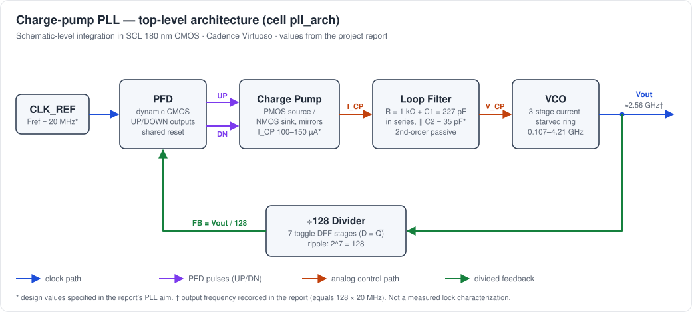
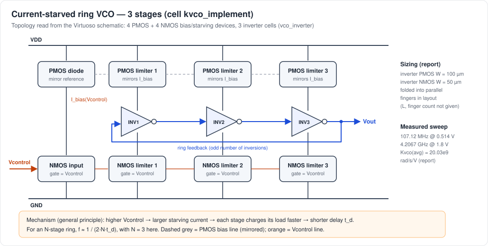
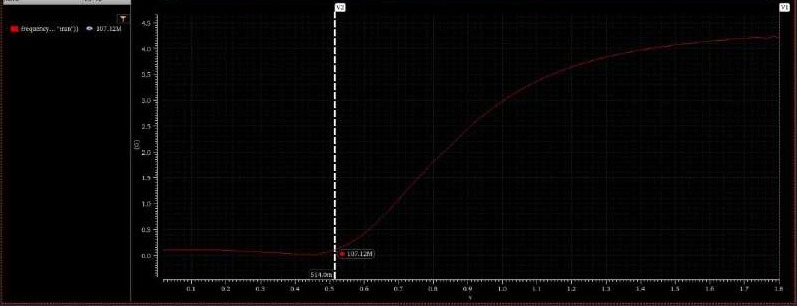
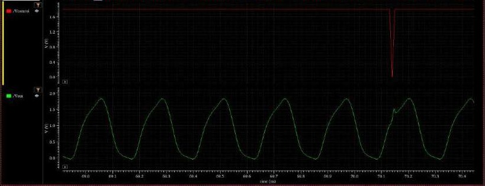
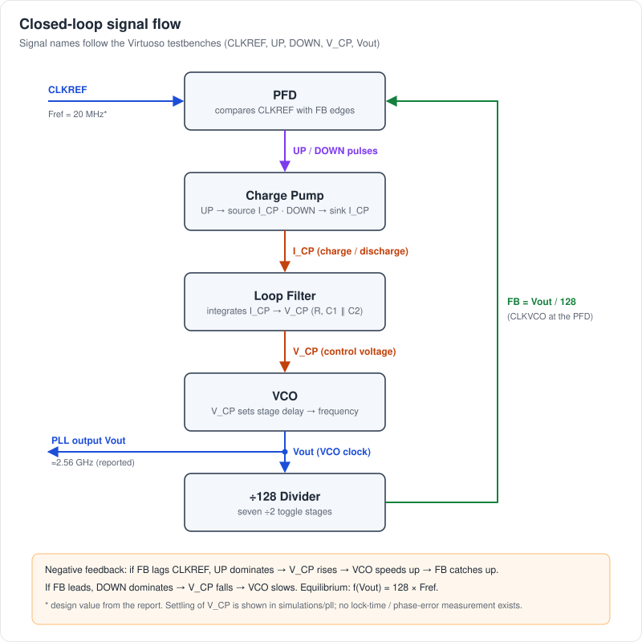
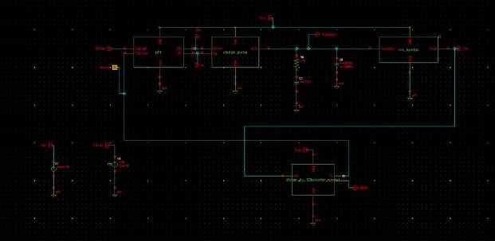
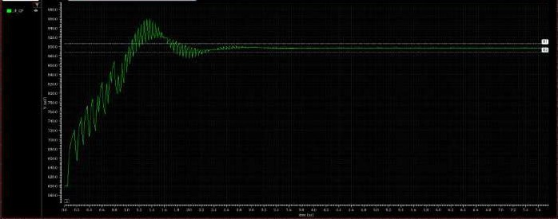

# Full-Custom PLL Design in Cadence Virtuoso

**Transistor-level PFD, VCO, charge pump, loop filter, divide-by-128 feedback, and physical layout in 180 nm CMOS (SCL 180 nm)**

A charge-pump phase-locked loop designed from transistors up in Cadence Virtuoso:

- a dynamic CMOS phase-frequency detector;
- a three-stage current-starved ring VCO, simulated from 107 MHz to 4.21 GHz;
- a current-mirror charge pump;
- a second-order passive loop filter;
- a seven-stage ÷128 ripple divider built from NAND-gate flip-flops.

The blocks were simulated in Spectre (ADE L), integrated into a closed-loop PLL targeting 128 × 20 MHz = 2.56 GHz, laid out in full custom, and checked with Calibre DRC.

This repository presents the design evidence: real schematic, waveform, layout and DRC screenshots from the project, with every number traced to its source. Results that were **not** measured are stated as such.

---

## Key specifications

| Feature | Implementation |
|---|---|
| Technology | SCL 180 nm CMOS (`ts018_scl_prim`) |
| EDA | Cadence Virtuoso: Schematic Editor L, ADE L with **Spectre**, Visualization & Analysis XL, Layout Suite XL |
| PFD | transistor-level dynamic CMOS PFD (precharge PMOS + NMOS evaluate, inverter output buffers, shared N1–N4 reset network) |
| VCO | 3-stage current-starved ring; inverter devices W<sub>P</sub> = 100 µm / W<sub>N</sub> = 50 µm, folded into fingers |
| VCO range (schematic) | **107.12 MHz @ 0.514 V → 4.2067 GHz @ 1.8 V**; average K<sub>VCO</sub> 20.03 × 10⁹ rad/s/V; tuning range 190.067 % |
| Charge pump | reference current mirrored to PMOS source / NMOS sink branches switched by UP / DOWN; 12 MOSFETs + ideal I<sub>ref</sub>; W/L tuned for matched charge/discharge |
| Loop filter | 2nd-order passive: R = 1 kΩ + C1 = 227 pF in series, ‖ C2 = 35 pF (design values) |
| Divider | **÷128** = 7 toggle D flip-flops (D = Q̅), each made of 6 NAND gates; 50 % output duty cycle |
| PLL design point | F<sub>ref</sub> = 20 MHz, N = 128, I<sub>CP</sub> = 100–150 µA; recorded output 2.56 GHz |
| Layout | full custom: 4 leaf cells, 5 blocks, top-level `pll_arch` |
| DRC | Calibre: no geometric violations shown; **one foundry density/coverage rule open per cell** (`GC.C.1`, or `M2.C.1` on the VCO) |
| LVS / extraction | not performed |

---

## PLL architecture



The **clock path** runs CLKREF → PFD, and Vout → ÷128 → PFD. The **control path** runs PFD → charge pump → loop filter → VCO:

1. The PFD compares the 20 MHz reference with the divided VCO clock and emits `UP` or `DOWN` pulses as wide as the timing error.
2. The charge pump turns each pulse into a packet of charge ±I<sub>CP</sub>·t.
3. The loop filter integrates that charge into the control voltage `V_CP`.
4. `V_CP` sets the VCO's starving current, and with it its frequency.
5. The ÷128 divider returns `Vout/128` to the PFD, closing the negative-feedback loop.

The loop settles when `Vout/128` lines up with the reference, i.e. at 2.56 GHz.

### Why a PLL?

- **Frequency synthesis.** A low-frequency reference (20 MHz) is multiplied to a GHz clock by the divider ratio: f<sub>out</sub> = N · f<sub>ref</sub>.
- **Phase alignment.** Feedback removes frequency error *and* drives phase error towards a small static value.
- **The divider sets the multiplication.** Changing N changes the output frequency without touching the oscillator.

---

## Block-level architecture

| Block | Diagram | Detailed doc |
|---|---|---|
| Closed loop | [pll-loop.svg](assets/pll-loop.svg) | [pll-integration.md](docs/pll-integration.md) |
| PFD | [pfd-architecture.svg](assets/pfd-architecture.svg) | [pfd.md](docs/pfd.md) |
| VCO | [vco-architecture.svg](assets/vco-architecture.svg) | [vco.md](docs/vco.md) |
| Charge pump | [charge-pump-architecture.svg](assets/charge-pump-architecture.svg) | [charge-pump.md](docs/charge-pump.md) |
| Loop filter | (in block diagram) | [loop-filter.md](docs/loop-filter.md) |
| Divider | [divider-architecture.svg](assets/divider-architecture.svg) | [divider.md](docs/divider.md) |

---

## Phase-Frequency Detector


- **Inputs:** `CLKREF` and the feedback clock (`CLKVCO` in the stand-alone testbench).
- **Outputs:** `UP` and `DOWN`.
- An edge on one input sets that side's output. When both outputs are high, the N1–N4 NMOS network resets both.
- `UP` therefore lasts for the time by which the reference leads; `DOWN` lasts for the time by which the feedback leads.

The design is transistor-level and dynamic: precharge PMOS pairs, input NMOS devices and inverter buffers (INV1–INV4). The design aim was a 2π-detection-range PFD; that range was not measured.

| PFD schematic | PFD transient (`DOWN`, `UP`, `CLKREF`, `CLKVCO`, 0–1 µs) |
|---|---|
|  |  |

The waveform shows wide `UP` pulses and only narrow `DOWN` spikes, which means the reference leads. The narrow spikes are the reset-overlap pulses. That brief overlap is what prevents a dead zone for small phase errors. The report also notes that asymmetric clock routing would add phase delay and widen the dead zone, so the two halves are laid out symmetrically. → [docs/pfd.md](docs/pfd.md)

---

## Voltage-Controlled Oscillator



The VCO is a three-inverter ring. Each inverter's pull-up and pull-down current is limited by PMOS and NMOS devices mirrored from an input NMOS whose gate is `Vcontrol`:

- higher `Vcontrol` → more current → shorter stage delay t<sub>d</sub> → higher f ≈ 1/(2·3·t<sub>d</sub>).

The inverter devices are large (100 µm PMOS, 50 µm NMOS) and were folded into parallel fingers in layout. The folding lowers gate resistance and junction capacitance.

| f vs. V<sub>control</sub> (ADE calculator `frequency()` over a 0–1.8 V parametric sweep) | Transient oscillation |
|---|---|
|  |  |

| Metric | Value (report) |
|---|---|
| f<sub>min</sub> | 107.12 MHz @ 0.514 V |
| f<sub>max</sub> | 4.2067 GHz @ 1.8 V |
| K<sub>VCO</sub> (average) | 2π(f<sub>max</sub> − f<sub>min</sub>)/(V<sub>max</sub> − V<sub>min</sub>) = **20.03 × 10⁹ rad/s/V** (≈ 3.19 GHz/V) |
| f<sub>c</sub>, tuning range | 2.15691 GHz, 190.067 % |

The f–V curve is strongly non-linear: flat below about 0.5 V, steep between about 0.6 and 1.1 V, and saturating towards 4.2 GHz. The quoted K<sub>VCO</sub> is an end-point average. The small-signal gain at the PLL operating point was not extracted. → [docs/vco.md](docs/vco.md)

---

## Charge Pump


| PFD state | Action | V<sub>CP</sub> |
|---|---|---|
| `UP` | PMOS branch sources I<sub>CP</sub> | rises linearly (per pulse) |
| `DOWN` | NMOS branch sinks I<sub>CP</sub> | falls linearly |
| neither | high impedance | held (minor leakage) |


*Test: identical pulse train into `Up` of one instance (Out1) and `Down` of another (Out2).* The two staircases are close to mirror images and cross near mid-supply (about 0.9 V). This is the report's evidence that charging and discharging became symmetric after the mirror W/L ratios were adjusted.

The report also observes:

- even small I<sub>up</sub>/I<sub>dn</sub> mismatch produces a phase offset or dead zone;
- charge sharing causes voltage spikes at the switching instants.

→ [docs/charge-pump.md](docs/charge-pump.md)

---

## Loop Filter

The implemented filter is a **second-order passive filter** at the charge-pump output: **R = 1 kΩ in series with C1 = 227 pF**, in parallel with **C2 = 35 pF**. These are design values from the PLL specification, and the topology is visible in the `pll_arch` schematic.

- C1 integrates the charge-pump current (type-II loop).
- R adds the stabilising zero, at f<sub>z</sub> ≈ 701 kHz.
- C2 smooths the per-pulse I<sub>CP</sub>·R step, adding a pole at f<sub>p</sub> ≈ 5.25 MHz.

f<sub>z</sub> and f<sub>p</sub> are calculated from the design values. In the stand-alone charge-pump test the "loop filter" is just a single capacitor.

Loop bandwidth and phase margin are **not** reported, because they need the small-signal K<sub>VCO</sub> and I<sub>CP</sub> at the operating point. → [docs/loop-filter.md](docs/loop-filter.md)

---

## Divide-by-128 Feedback Divider


```
7 toggle stages  →  ÷2 per stage  →  2^7 = 128  →  f_out = f_in / 128   (50 % duty cycle, reported)
```

Each D flip-flop has D tied to Q̅ and is built from six transistor-level NAND gates (`nand_2` and `nand_3`). Each stage's output clocks the next, forming an asynchronous ripple counter.

| Stage outputs (`clk`, `net1`…`net11`, `Q`, 0–5 µs) | ÷128 output (`Q`, `clk`, `~Q`, 0–37 µs) |
|---|---|
|  |  |

Clock-to-Q delays accumulate down a ripple chain. Inside a PLL that accumulated delay is a phase offset, and its variation is feedback jitter. Stage 1 must also toggle at the full VCO frequency and burns the most dynamic power. The report notes that synchronous or CML dividers are preferred at very high frequency. → [docs/divider.md](docs/divider.md) · [conceptual timing](assets/frequency-division.svg)

---

## Complete PLL Integration



**Specification** (from the report's PLL aim):

- output: 2.5 GHz target;
- F<sub>ref</sub> = 20 MHz;
- R = 1 kΩ, C = 227 pF, C2 = 35 pF;
- I<sub>CP</sub> = 100–150 µA;
- 600 mV initial condition on the filter.

With N = 128 the loop must settle at 128 × 20 MHz = **2.56 GHz**, which is the output frequency recorded in the report.



### Locking behaviour



The closed-loop transient shows `V_CP`:

- starting at about 0.6 V (the initial condition);
- climbing in a sawtooth staircase of charge-pump packets at the reference rate;
- overshooting to about 0.96 V;
- ringing down to a steady level of about 0.9 V within the first few microseconds.

This is the under-damped acquisition expected from a type-II charge-pump PLL. On the stand-alone VCO curve, about 0.9 V corresponds to roughly 2.5–2.6 GHz, which agrees with the recorded 2.56 GHz. All of these voltage values are visual readings from a screenshot.

> **What is and isn't demonstrated.** The repository documents closed-loop acquisition and settling of the control voltage, and a recorded 2.56 GHz output. **A formal lock characterisation is not available.** There is no measured lock time, no simulated `frequency(Vout)` readout, no phase-error measurement, and no jitter or phase-noise analysis.

Full overview with `Vout`, `V_CP` and the PFD outputs: [pll-transient-overview.jpg](simulations/pll/pll-transient-overview.jpg). → [docs/pll-integration.md](docs/pll-integration.md)

---

## Simulation Methodology

| Item | What was used |
|---|---|
| Environment | Virtuoso ADE L, simulator **Spectre** |
| Analyses | transient; parametric sweep (VCO `Vcontrol` 0 → 1.8 V) |
| Stimuli | `vpulse` sources for clocks, UP/DOWN and V<sub>control</sub>. VCO example: 0 → 1.8 V, 10 ns period, 10 ps edges, 1 µs stop time. |
| Measurements | ADE calculator `frequency(getData("/Vout" ?result "tran"))` vs. V<sub>control</sub>; marker readouts; hand calculation of K<sub>VCO</sub> and tuning range |
| Initial conditions | 600 mV on the PLL loop-filter node (design value) |
| Level | schematic only; no extracted netlists |

Step-by-step rebuild: [docs/reproduction.md](docs/reproduction.md). The repository contains no Cadence database or PDK files, so nothing can be re-simulated directly from it.

---

## Waveform evidence

All waveforms are real Virtuoso screenshots, cropped to the plot area.

| Block | Signals | Image |
|---|---|---|
| PFD | `CLKREF`, `CLKVCO`, `UP`, `DOWN` | [pfd-transient-up-down](simulations/pfd/pfd-transient-up-down.jpg) |
| PFD inverter | Vin, Vout | [pfd-inverter-transient](simulations/pfd/pfd-inverter-transient.jpg) |
| VCO | `Vcontrol`, `Vout` | [vco-transient-oscillation](simulations/vco/vco-transient-oscillation.jpg) · [pulse run](simulations/vco/vco-transient-vcontrol-pulse.jpg) |
| VCO | f vs. V<sub>control</sub> | [vco-frequency-vs-vcontrol](simulations/vco/vco-frequency-vs-vcontrol.jpg) |
| VCO | parametric `Vout` overlays | [sweep](simulations/vco/vco-parametric-sweep.jpg) · [zoom](simulations/vco/vco-parametric-sweep-zoom.jpg) |
| Charge pump | `Up`, `Down`, `Out1`, `Out2` | [charge-pump-transient](simulations/charge-pump/charge-pump-transient.jpg) |
| Divider | `clk`, 7 stage outputs | [divider-stage-outputs](simulations/divider/divider-stage-outputs.jpg) |
| Divider | `Q`, `clk`, `~Q` | [divide-by-128-transient](simulations/divider/divide-by-128-transient.jpg) |
| DFF / NAND3 | toggle / truth-table checks | [dff-toggle](simulations/divider/dff-toggle-transient.jpg) · [nand3](simulations/divider/nand3-transient.jpg) |
| PLL | `V_CP` | [pll-control-voltage-vcp](simulations/pll/pll-control-voltage-vcp.jpg) |
| PLL | `Vout`, clock, `V_CP`, DN, UP | [pll-transient-overview](simulations/pll/pll-transient-overview.jpg) |

Images whose filenames end in `hand-drawn` or `hand-written` are notebook pages: expected waveforms, circuits and calculations. They are **not** simulation output. The only drawn timing diagram, [frequency-division.svg](assets/frequency-division.svg), is labelled *conceptual*.

---

## Physical Layout


Every block was laid out in Virtuoso Layout Suite XL, bottom-up from leaf cells.

| PFD | VCO | Charge pump |
|---|---|---|
|  |  |  |

| ÷128 divider (7 × `d_ff`) | Complete PLL (`pll_arch`) |
|---|---|
|  |  |

**Layout techniques documented in the report:**

- multi-finger folding of the 100 µm / 50 µm VCO devices, for compactness and lower gate resistance and junction capacitance;
- symmetric placement and routing of the PFD clock paths, to avoid artificial phase delay and dead zone;
- matched routing between VCO delay stages, to avoid delay mismatch that becomes jitter and phase noise;
- a regular row of identical DFF cells in the divider.

In the top-level layout, seven repeated cells (consistent with the divider flip-flops) and a large-device block are visible. Blocks are not labelled in the original, so **no annotated version is provided** to avoid guessing. → [docs/layout.md](docs/layout.md)

---

## DRC / LVS

### DRC: Calibre

| Cells checked | Result per cell |
|---|---|
| inverter, `vco_inverter`, `nand_2`, `nand_3`, `pfd_implement`, `charge_pump`, `d_ff`, `divided_by_128counter`, `pll_arch` | 1 result: `GC.C.1` (GC coverage < 0.1), a **density rule** |
| `vco_layout` | 1 result: `M2.C.1` (M2 coverage < 0.20), a **density rule** |

No spacing, width or enclosure violations appear in any run. The report calls this "no critical issues". However, **each cell still carries one open foundry density/coverage violation**. The report says it was left deliberately, to avoid adding fill with unknown parasitics. The design is therefore *not* DRC-clean for tape-out; fill or a waiver would be needed. Screenshots: [reports/drc/](reports/drc). → [docs/physical-verification.md](docs/physical-verification.md)

### LVS

**Not performed.** There is no LVS evidence in the project.

---

## Parasitic and layout considerations

| Parasitic | Effect on this PLL |
|---|---|
| Routing capacitance on VCO ring nodes | larger stage load, longer t<sub>d</sub>, lower f<sub>max</sub>. The report *expects* post-layout f<sub>max</sub> below 4.2 GHz (not measured). |
| Gate / routing resistance | slower edges; mitigated by finger folding |
| PFD clock-path mismatch | static phase offset and a wider dead zone |
| Unequal VCO stage loading | delay mismatch, which becomes jitter and phase noise |
| Charge-pump switch-node capacitance | charge sharing, which appears as spikes on V<sub>CP</sub> |
| Divider ripple delay | phase offset; delay variation becomes feedback jitter |

No RC extraction or post-layout simulation was performed. Every entry above is a qualitative design consideration, not a measured degradation.

---

## Results

| Block | Metric | Result | Evidence |
|---|---|---:|---|
| VCO | f<sub>min</sub> / f<sub>max</sub> | 107.12 MHz / 4.2067 GHz | report p. 10–12 |
| VCO | K<sub>VCO</sub> (average) | 20.03 × 10⁹ rad/s/V | report p. 12 |
| VCO | tuning range | 190.067 % | report p. 13 |
| Charge pump | charge/discharge symmetry | symmetric after W/L tuning (ramps cross ≈ 0.9 V, visual) | report p. 19, screenshot |
| Loop filter | R / C1 / C2 | 1 kΩ / 227 pF / 35 pF (design) | report p. 29 |
| Divider | division ratio | **128** | report p. 25 |
| Divider | duty cycle | 50 % | report p. 25 |
| PLL | F<sub>ref</sub> × N | 20 MHz × 128 = 2.56 GHz | spec + calc |
| PLL | recorded output | 2.56 GHz | report p. 30 (handwritten) |
| PLL | V<sub>CP</sub> settling | ≈ 0.6 V → ≈ 0.96 V peak → ≈ 0.9 V (visual) | screenshot |
| Layout | DRC | 1 density rule per cell, no geometric violations | Calibre screenshots |

Full table with evidence for every number: [docs/results.md](docs/results.md).

---

## Design tradeoffs

**Observed in this project:**

| Tradeoff | Observation |
|---|---|
| **VCO speed vs. parasitics** | Large 100 µm / 50 µm devices give 4.2 GHz at schematic level, but their capacitance and the routing will lower f<sub>max</sub> after layout. Finger folding was used to limit gate resistance and junction capacitance. |
| **Current matching vs. area** | Charge-pump symmetry was achieved by re-sizing mirror W/L. Larger devices match better but add switch-node capacitance and charge sharing. |
| **Divider simplicity vs. ripple delay** | A NAND-based ripple counter is compact and modular (7 identical cells), but delay accumulates per stage and stage 1 must run at the full VCO rate. The report notes synchronous or CML dividers for higher speed. |
| **Routing symmetry vs. layout complexity** | Symmetric PFD and VCO routing costs extra effort and area but avoids artificial phase offset, dead zone and jitter. |
| **Compact layout vs. density rules** | Compact cells left density rules unmet. Fill would fix DRC but adds parasitics, so it was deferred. |
| **Charge-pump mismatch vs. phase error** | Any residual I<sub>up</sub>/I<sub>dn</sub> mismatch shows up as static phase offset and reference-rate ripple on V<sub>CP</sub>. |

**General principles, not measured here:**

- A wider tuning range gives a larger K<sub>VCO</sub>, which makes the VCO more sensitive to noise on V<sub>CP</sub>.
- A larger C1 makes the loop slower but cleaner.
- A larger C2 reduces ripple at the cost of phase margin.

---

## Technical learnings

- **Device sizing sets the oscillator's range.** The current-starved ring spans about 40× in frequency. The useful, near-linear region is only about 0.6–1.1 V, so an average K<sub>VCO</sub> overstates linearity, and the operating-point gain is what matters for the loop.
- **Matching is a sizing problem before it is a layout problem.** The charge pump only became symmetric after mirror W/L tuning. Mismatch directly becomes PLL phase offset.
- **A charge pump plus capacitor is an integrator.** The staircase output, with equal steps per pulse, makes the "phase error → charge → voltage" chain visible.
- **The PFD's dead zone comes from timing.** The deliberate reset overlap, and symmetry between the two halves, determine whether small phase errors are seen.
- **Ripple counters trade speed for simplicity.** Clock-to-Q accumulates over 7 stages, and the first stage carries the full VCO frequency and most of the dynamic power.
- **Feedback dynamics are visible in transient.** The V<sub>CP</sub> overshoot and ringing show the second-order loop behaviour set by R, C1 and C2.
- **Layout introduces new constraints.** Finger folding, symmetric routing and density rules all appeared only once the design moved from schematic to layout.
- **Read DRC results precisely.** "No critical issues" and "DRC clean" are different statements, and density rules gate tape-out.

---

## Limitations

- **No LVS.** Layout-to-schematic equivalence is not verified.
- **No parasitic extraction or post-layout simulation.** All performance figures are schematic-level.
- **No quantified lock characterisation:** no lock time, no simulated output-frequency measurement, no phase-error measurement.
- **No phase-noise, jitter or spur analysis.**
- **Only an average K<sub>VCO</sub>.** The small-signal gain at the operating point and the loop bandwidth, phase margin and damping were not computed.
- **No charge-pump current measurements** (I<sub>up</sub>, I<sub>dn</sub>, mismatch versus V<sub>out</sub>) and no divider speed limit.
- **No power or area figures. No PVT or Monte Carlo analysis.**
- **One density-rule violation per cell remains open.**
- **The loop filter appears to be schematic-only.** No R/C is identifiable in the top-level layout.
- **The original Cadence database, netlists and ADE states are not included.**

## Future work

These are planned characterisation steps; none has been performed.

- Calibre **LVS** on every block and on `pll_arch`.
- Density **fill**, followed by a DRC re-run.
- **RC extraction** (PEX/Quantus) and **post-layout simulation** of the VCO f–V curve, the divider and the closed loop.
- **Small-signal K<sub>VCO</sub>** around the 0.9 V operating point, then **loop bandwidth / phase margin** from I<sub>CP</sub>, R, C1, C2 and N.
- Closed-loop **lock-time** and **static phase-error** measurement; `frequency(Vout)` readout.
- **Phase-noise** (PSS + Pnoise) and **jitter** analysis; reference-spur measurement.
- **Charge-pump mismatch characterisation** across V<sub>out</sub>, and switch-spike reduction (dummy switches, a unity-gain buffer).
- **PVT corners** and **Monte Carlo** mismatch analysis.
- **Divider speed**: maximum toggle frequency of the first stage; a TSPC, synchronous or CML first stage.
- **Power** measurement and optimisation; layout of the loop filter (MOS/MIM capacitors); top-level floorplan and labelling.

---

## Conclusion

This project takes a charge-pump PLL from transistor-level schematics to full custom layout in SCL 180 nm CMOS using Cadence Virtuoso.

**Verified by the evidence:**

- **PFD:** a dynamic CMOS PFD with shared reset produces the expected UP/DOWN behaviour.
- **VCO:** a current-starved ring tunes from 107.12 MHz to 4.2067 GHz (schematic level).
- **Charge pump:** a current-mirror charge pump charges and discharges symmetrically after sizing.
- **Divider:** a seven-stage NAND-DFF ripple counter divides by exactly 128 with a 50 % duty cycle.
- **Closed loop:** with a 1 kΩ / 227 pF / 35 pF second-order filter, a 20 MHz reference and ÷128 feedback, the closed-loop transient shows the control voltage acquiring and settling. The report records a 2.56 GHz output.
- **Layout:** every block and the top level were laid out. Calibre DRC shows no geometric violations, with one density rule per cell intentionally left open.

**Not established:** LVS, post-layout performance, lock time, jitter, phase noise, loop bandwidth and power. These are the next characterisation steps, and the repository makes no claims about them.

---

## Documentation

| Doc | Contents |
|---|---|
| [docs/pll-overview.md](docs/pll-overview.md) | PLL principle and block map |
| [docs/pfd.md](docs/pfd.md) | PFD circuit, states, transient, layout, DRC |
| [docs/vco.md](docs/vco.md) | VCO topology, sizing, f–V, K<sub>VCO</sub>, layout |
| [docs/charge-pump.md](docs/charge-pump.md) | charge-pump circuit, test, mismatch, charge sharing |
| [docs/loop-filter.md](docs/loop-filter.md) | filter topology, values, derived zero/pole |
| [docs/divider.md](docs/divider.md) | ÷128 ripple counter, DFF, ripple delay |
| [docs/pll-integration.md](docs/pll-integration.md) | top level, signal flow, locking behaviour |
| [docs/layout.md](docs/layout.md) | layouts and parasitic considerations |
| [docs/physical-verification.md](docs/physical-verification.md) | DRC details, LVS / PEX status |
| [docs/results.md](docs/results.md) | every number with its source |
| [docs/reproduction.md](docs/reproduction.md) | how to rebuild the design |
| [docs/evidence-audit.md](docs/evidence-audit.md) | sources, page map, inconsistencies, claims not to make |

## Repository layout

```
├── README.md
├── assets/        technical SVG diagrams (architecture, loop, flows, conceptual timing)
├── docs/          detailed per-block documentation
├── schematics/    Virtuoso schematic screenshots + hand-drawn circuits (pfd, vco, charge-pump, divider, pll)
├── simulations/   Virtuoso waveform screenshots + notebook calculations (per block)
├── layout/        Virtuoso layout screenshots (per block + top level)
└── reports/       Calibre DRC result screenshots (reports/drc); LVS status (reports/lvs)
```

---

*Author: Tanisha Gupta. Coursework project, CMOS Analog IC Design, Winter Semester 2025-26. Screenshots were cropped from the original project reports to remove EDA-server hostnames and user paths.*
