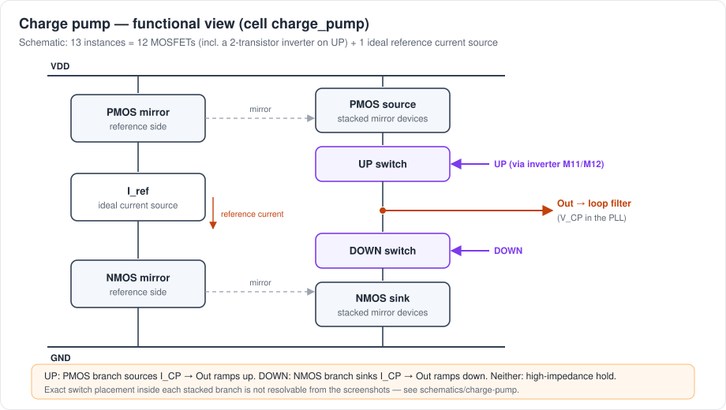
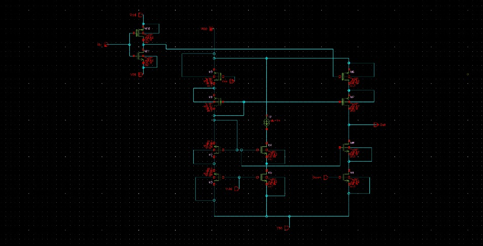
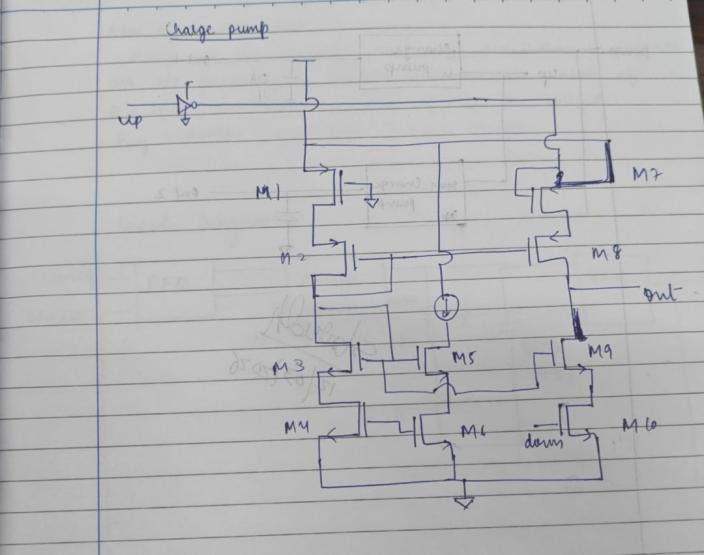
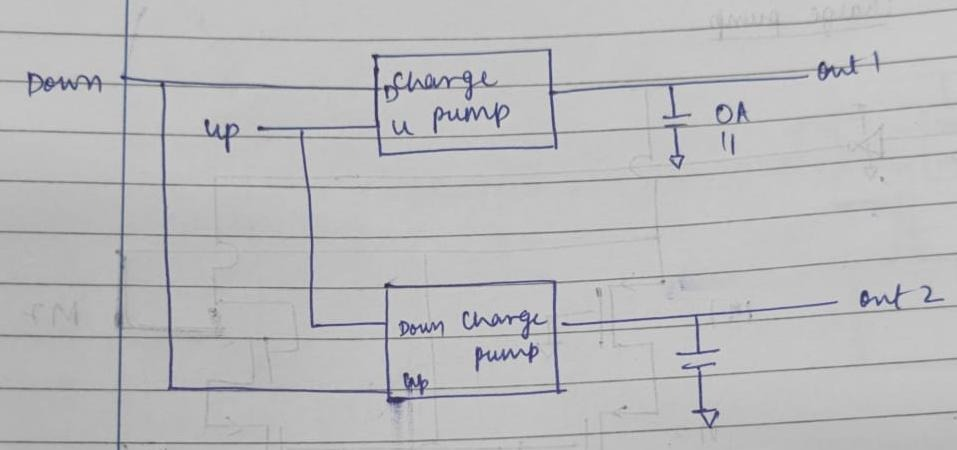
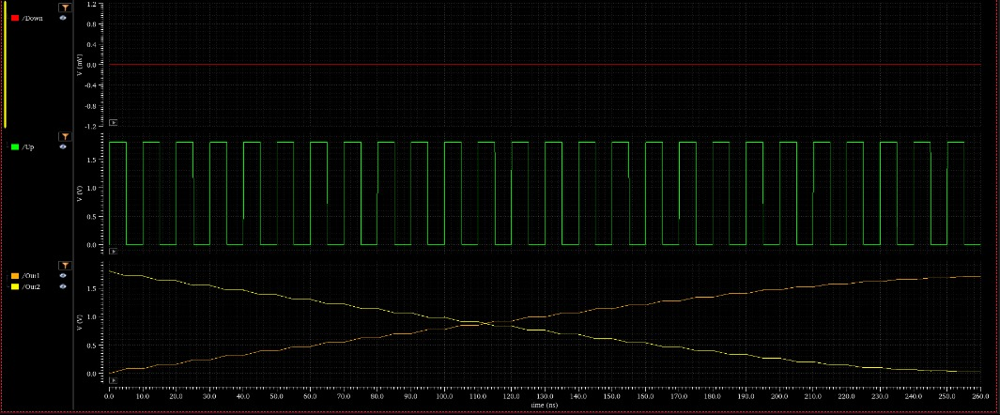

# Charge Pump

> Evidence: [R1] pp. 16–20 and [R2] pp. 2–5 (same experiment; [R2] has higher-resolution screenshots) · [`schematics/charge-pump/`](../schematics/charge-pump) · [`simulations/charge-pump/`](../simulations/charge-pump) · [`layout/charge-pump/`](../layout/charge-pump)

## 1. Role in the PLL

The charge pump turns the PFD's digital `UP`/`DOWN` pulses into a **current** into or out of the loop-filter node:

| PFD state | Charge-pump action | Loop-filter node (V_CP) |
|---|---|---|
| `UP` = 1, `DOWN` = 0 | PMOS branch sources I_CP | rises |
| `UP` = 0, `DOWN` = 1 | NMOS branch sinks I_CP | falls |
| both 0 | both branches off (high impedance) | held, apart from leakage |
| both 1, during the PFD reset overlap | source and sink both on | net current ≈ I_up − I_dn, which is zero only if the branches are matched |

The charge delivered per reference cycle is I_CP × (pulse width), and the pulse width is proportional to the phase error. The charge pump plus capacitor therefore acts as an **integrator of phase error**. [R1] p. 19 puts it this way: *"the output voltage is determined by pulse width of input signal, thus acting as an integral stage in PLL systems."*

## 2. Circuit

Procedure ([R1] p. 17, [R2] pp. 3–4): PMOS transistors are used as current sources for charging and NMOS transistors as current sinks for discharging. *"Use current mirrors to set constant and equal currents."* `UP` drives the PMOS branch and `DOWN` drives the NMOS branch, and *"a capacitor [is connected] on the output node as a loop filter."*

The Virtuoso schematic (`charge_pump`, [R2] p. 4) contains **13 instances**:

- **12 MOSFETs.** The hand drawing labels them M1–M10, plus M11/M12, which form the inverter at the `UP` input (the drawing shows an inverter symbol on `up`). The inversion is needed because a PMOS switch turns on with a low gate.
- **1 ideal reference current source** (the circle symbol in the centre of the drawing). It sets the mirror reference current.

The current is mirrored into a stacked PMOS output branch, which sources current, and a stacked NMOS output branch, which sinks it. Both meet at `Out`. The screenshot resolution does not allow every gate connection to be traced, so which transistor in each stack is the switch and which is the mirror device is **not asserted here**.

| Virtuoso schematic | Hand-drawn circuit |
|---|---|
|  |  |

Symbol: [charge-pump-symbol.jpg](../schematics/charge-pump/charge-pump-symbol.jpg). Pins: `Up`, `Down`, `Out`, `Vdd`, `Vss`.

**Current value.** The PLL design specification gives **I_CP = 100–150 µA** ([R1] p. 29). The reference current actually set in the source, and any measured branch current, are not shown in the reports.
**Transistor W/L values:** not documented. The report states only that the W/L ratios of the current-mirror transistors were *adjusted* to equalise charging and discharging.

## 3. Test setup

Two identical `charge_pump` instances are driven with the **same pulse train**:

- Instance 1: pulse on `Up` and `Down` held low, so `Out1` should charge its capacitor.
- Instance 2: the same pulse on `Down` and `Up` held low, so `Out2` should discharge its capacitor.

Comparing the two ramps side by side shows directly whether the sourcing and sinking currents match. Virtuoso testbench: [charge-pump-testbench.jpg](../schematics/charge-pump/charge-pump-testbench.jpg). Expected waveform: [charge-pump-expected-hand-drawn.jpg](../simulations/charge-pump/charge-pump-expected-hand-drawn.jpg).

## 4. Transient result

What the screenshot shows ([R2] p. 5):

- `/Down` is flat at 0 V and `/Up` is a 0 → 1.8 V pulse train.
- `/Out1` climbs from about 0 V towards the upper rail, and `/Out2` falls from about 1.8 V towards 0 V.
- Both ramps are **staircases**. Each pulse adds or removes a fixed charge packet, and the output is held flat between packets: the high-impedance state.
- The two ramps are close to mirror images and **cross near mid-supply, around 0.9 V**. This is the visual evidence for the report's claim that charging and discharging became *"symmetrically done after adjusting the W/L ratios"*.

Reported results ([R1] p. 19, [R2] p. 5):

> *"UP signal successfully activated the PMOS current source, hence producing a linear increase in output voltage. DOWN signal activated the NMOS current source, thereby producing a linear decrease in output voltage. When there was no UP and DOWN signals, then the output voltage became stable (high impedance state) except for some minor leakage."*

"Linear" refers to the envelope of the staircase: equal steps per pulse mean a constant average slope.

## 5. Non-idealities observed and discussed

| Effect | What the report says | Why it matters in the PLL (general) |
|---|---|---|
| **Current mismatch** I_up ≠ I_dn | *"even minimal variation in current produces phase offset or dead zone in a PLL system. This problem was minimized through adjusting the transistor ratio."* | At lock the net charge per cycle must be zero. With mismatch, the loop settles with a static phase offset, and the PFD's reset-overlap pulses inject a net charge every cycle, which shows up as ripple on V_CP and as reference spurs. |
| **Charge sharing / switching spikes** | *"some voltage spike on the output terminal during switch transients due to capacitance effect"* | When a switch closes, the parasitic capacitance at the internal node between switch and current source shares charge with the output. That produces a glitch on V_CP that disturbs the VCO for a short time. |
| **Leakage** | *"stable … except for some minor leakage"* | Leakage during the hold state slowly drifts V_CP and must be corrected by the loop every cycle. |
| **Output-voltage dependence** | not quantified | The mirror devices leave saturation as `Out` nears either rail, so I_up and I_dn depend on V_CP. Matching is best near the voltage where the ramps cross. |

The report did not measure I_up and I_dn against output voltage (a mismatch-versus-V_out sweep), nor spike amplitude or leakage current.

## 6. Layout and DRC

The charge pump was laid out as cell `charge_pump` ([R1] p. 19). Calibre DRC reports **one** result, the density rule `GC.C.1`: [DRC](../reports/drc/charge-pump-calibre-drc.jpg).

Layout intent for current matching (general practice, consistent with the report's emphasis on matching): keep mirror pairs adjacent and in the same orientation, use identical finger geometry for the reference and output devices, and route the `UP` and `DOWN` control paths with similar length so that the two branches switch at the same time. The screenshot shows the PMOS devices in the upper rows and the NMOS devices in the lower rows. The report does not describe a common-centroid or interdigitated arrangement, so none is claimed here.

## 7. Not available

- Numeric I_up and I_dn, and mismatch versus V_out.
- The loop-filter capacitor value used in this stand-alone test (the label is not legible).
- Spike amplitude, leakage current, power.
- Post-layout simulation.
