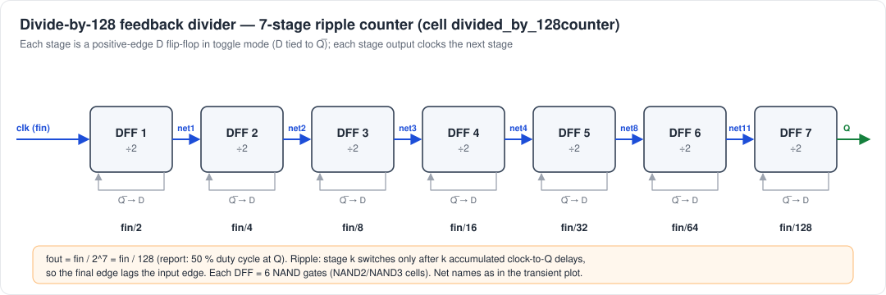
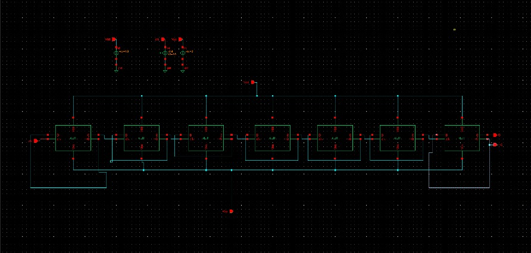
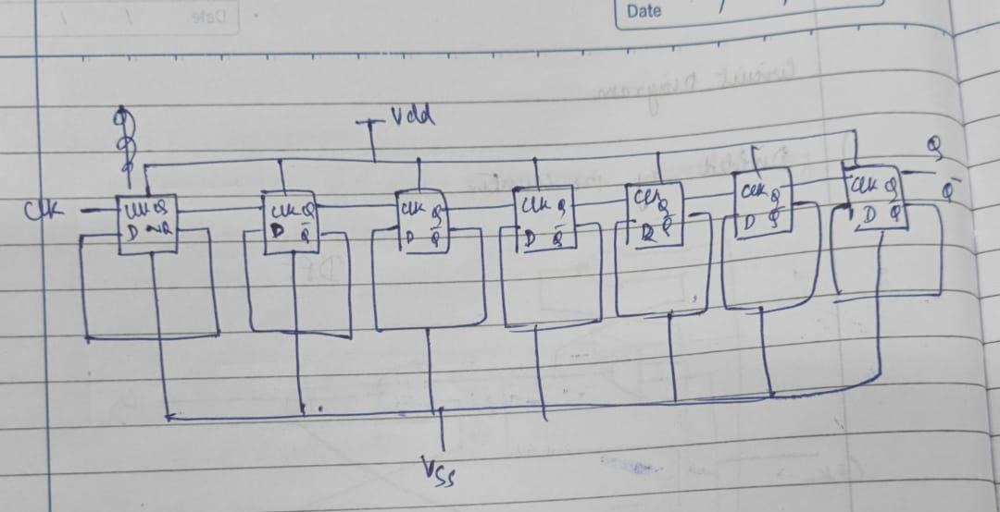
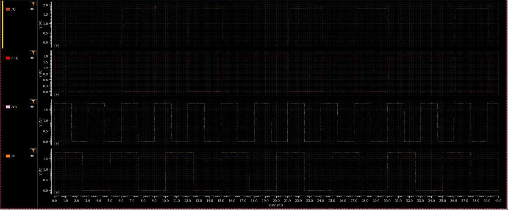
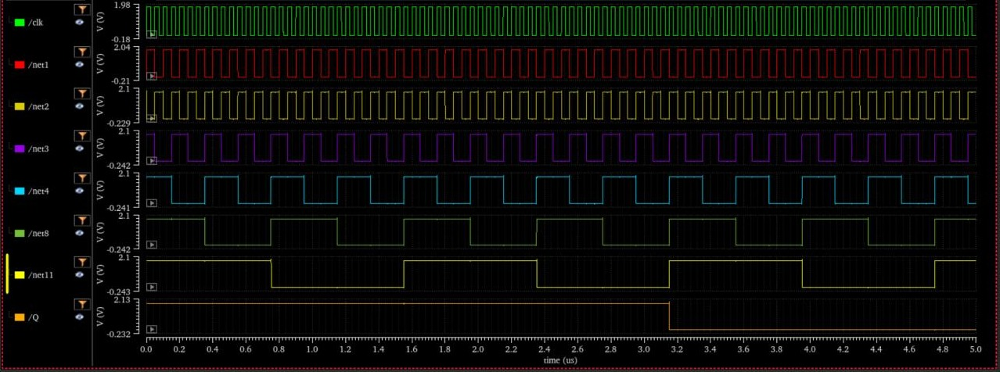
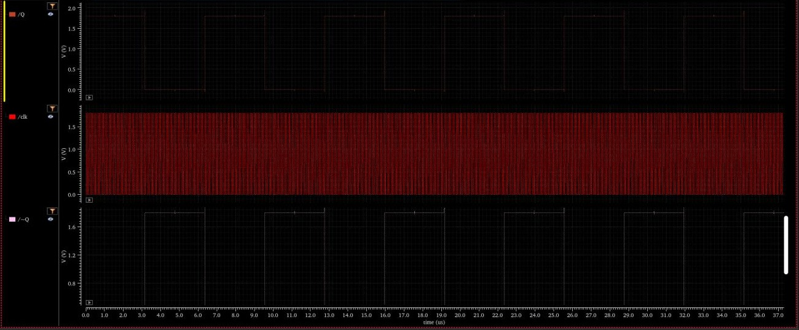
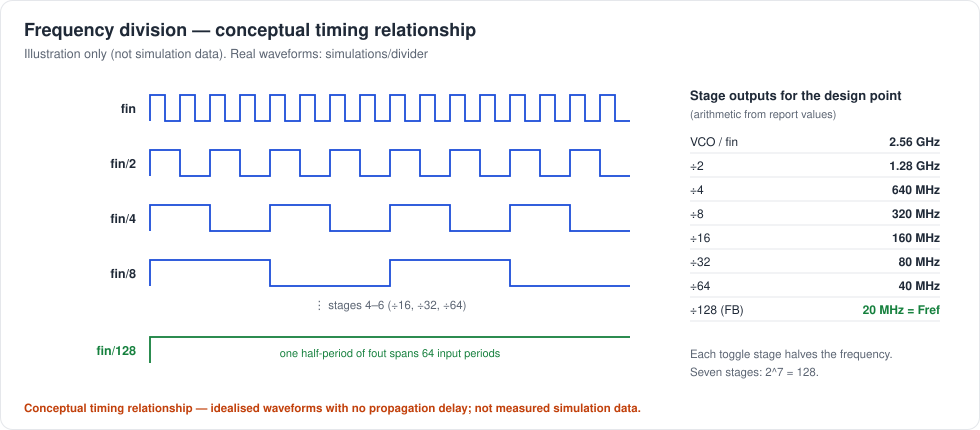
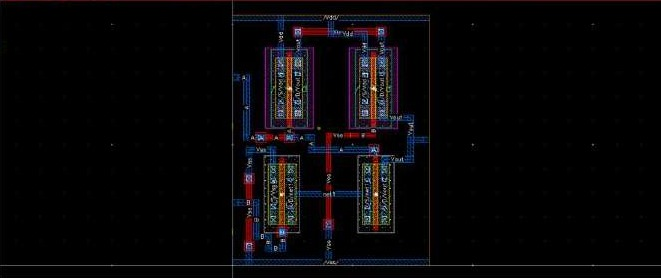
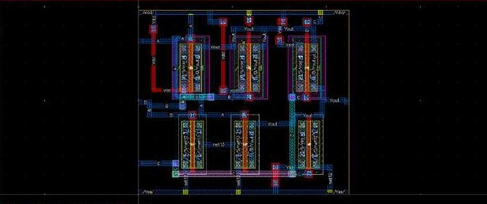
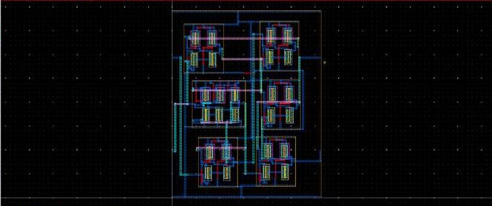

# Divide-by-128 Feedback Divider

> Evidence: [R1] pp. 21–28 and [R2] pp. 6–12 · [`schematics/divider/`](../schematics/divider) · [`simulations/divider/`](../simulations/divider) · [`layout/divider/`](../layout/divider)



## 1. Role in the PLL

The divider closes the loop. It scales the VCO output down to the reference frequency so that the PFD compares like with like. At equilibrium

```
f_FB = f_Vout / N  =  f_REF     →     f_Vout = N · f_REF = 128 × 20 MHz = 2.56 GHz
```

N = 128 is the multiplication factor of the PLL.

## 2. Architecture: 7-stage asynchronous (ripple) counter

From [R1] p. 25 and [R2] p. 11:

> *"A frequency divider chain was built using 7 stages of D-Flip-Flops in a toggling configuration (2^7 = 128). Transient analysis revealed that the frequency of each next stage was half the previous one. For the input clock frequency fin the output frequency was found to be exactly fin/128. Waveform of the output signal exhibited 50 % duty cycle, which matches expected behavior of D-FF in toggle mode."*

| Item | Value |
|---|---|
| Stages | 7 (seven `d_ff` instances in `divided_by_128counter`; 13 instances in total including testbench sources) |
| Stage configuration | D tied to Q̅, so each stage toggles on every active clock edge and divides by 2 |
| Clocking | asynchronous ripple: each stage is clocked by the output of the previous stage |
| Division ratio | 2 × 2 × 2 × 2 × 2 × 2 × 2 = 2⁷ = **128** |
| Output | f_out = f_in / 128 with a **50 % duty cycle** (report) |

| Divider schematic | Hand-drawn test circuit |
|---|---|
|  |  |

### 2.1 Flip-flop: built bottom-up from NAND gates

| Level | Cell | Evidence |
|---|---|---|
| Transistor | `nand_2`: 2 parallel PMOS + 2 series NMOS | [nand2-schematic.jpg](../schematics/divider/nand2-schematic.jpg) |
| Transistor | `nand_3`: 3 parallel PMOS + 3 series NMOS | [nand3-schematic.jpg](../schematics/divider/nand3-schematic.jpg) · [transient](../simulations/divider/nand3-transient.jpg) |
| Gate | `d_ff`: six NAND gates in the classic three-latch positive-edge-triggered D flip-flop | [dff-schematic.jpg](../schematics/divider/dff-schematic.jpg) · [hand-drawn](../schematics/divider/dff-gate-level-hand-drawn.jpg) |

Using NAND3 gates allows extra inputs for asynchronous set/clear. The procedure mentions *"integrate combinational logic gates for resetting purposes"*, but the reports show no active reset being applied in the divider testbench, so no reset behaviour is claimed.

**Single DFF in toggle mode** ([R2] p. 8): `Q` and `~Q` toggle at half the clock rate.



## 3. Simulation evidence

**Stage-by-stage outputs, 0–5 µs** ([R1] p. 25, [R2] p. 11). The traces are `/clk`, `/net1`, `/net2`, `/net3`, `/net4`, `/net8`, `/net11` and `/Q`.



Each successive trace toggles at half the rate of the one above it, which confirms the ÷2-per-stage behaviour. The final `/Q` makes only one transition inside this 5 µs window, so this plot alone cannot show the full output period or its duty cycle.

**Longer run, 0–37 µs** ([R2] p. 11): `/Q`, `/clk` and `/~Q`.



Over this window `Q` and `~Q` are complementary square waves whose high and low intervals look equal on visual inspection. This is the basis for the report's 50 % duty-cycle statement.

The input clock frequency used in each testbench is not stated in the report. This document therefore quotes no absolute input or output frequencies for the divider runs.

Conceptual timing (illustration, not data):



## 4. Ripple delay and why it matters inside a PLL

Each stage switches only after its own clock edge, which is the previous stage's output edge. So the k-th output edge lags the input edge by roughly

```
t_ripple(k) ≈ t_cq,1 + t_cq,2 + … + t_cq,k
```

[R1] p. 25: *"with increase in the number of stages in a ripple counter design, the clock-to-Q delay becomes an issue. 'Clock-to-Q' delay should be considered to maintain synchronization of the divider with the fast VCO in a PLL."*

Inside the PLL this means:

- **Constant delay → phase offset.** A fixed divider delay appears as a fixed phase shift between the VCO output and the reference. The loop locks to the *delayed* feedback edge.
- **Variable delay → jitter.** Supply noise and other disturbances modulate each t_cq. The accumulated variation over 7 stages appears directly as feedback-edge jitter, which the PFD cannot tell apart from VCO phase error.
- **First-stage speed limit.** Stage 1 must toggle at the full VCO frequency, up to 4.2 GHz on the VCO's measured curve and about 2.56 GHz at the design point. A static CMOS NAND-based DFF in 180 nm is fundamentally challenged at these rates. The report notes that *"when working with very high frequencies, Analog IC design may favor synchronous or CML dividers"*. The maximum toggle frequency of this DFF was **not** characterised.

**Dynamic power distribution** ([R1] p. 26): *"Initially designed stages work on higher frequencies and, thus, consume more dynamic power than the subsequent stages."* Since P ≈ α C V² f, stage k runs at f_in/2^(k−1). Stage 1 therefore dominates, and for equal per-stage capacitance the whole chain consumes less than twice what stage 1 alone does (a general result; power was not measured).

## 5. Layout and DRC

| Cell | Layout | Calibre DRC |
|---|---|---|
| `nand_2` |  | 1 result: `GC.C.1` (density) — [DRC](../reports/drc/nand2-calibre-drc.jpg) |
| `nand_3` |  | 1 result: `GC.C.1` (density) — [DRC](../reports/drc/nand3-calibre-drc.jpg) |
| `d_ff` |  | 1 result: `GC.C.1` (density) — [DRC](../reports/drc/dff-calibre-drc.jpg) |
| `divided_by_128counter` |  | 1 result: `GC.C.1` (density) — [DRC](../reports/drc/divide-by-128-calibre-drc.jpg) |

The divider layout is a single row of **seven identical `d_ff` instances** between shared `Vdd` (top) and `Vss` (bottom) rails, with the ripple connections routed above and between the cells. Abutting identical instances keeps every stage's internal parasitics the same. Stage-to-stage wiring is short and regular, which keeps the added clock-to-Q skew per stage small and roughly uniform. The effect was not quantified, because no extraction was run.

## 6. Not available

- Maximum operating (toggle) frequency of the DFF or the divider.
- Measured clock-to-Q delay per stage and total ripple delay.
- Power.
- Post-layout simulation.
- Reset or initialisation behaviour.
