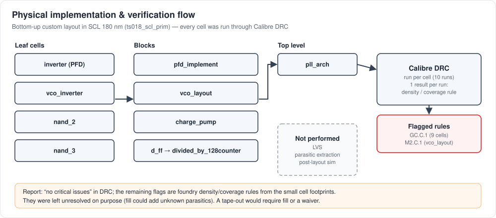
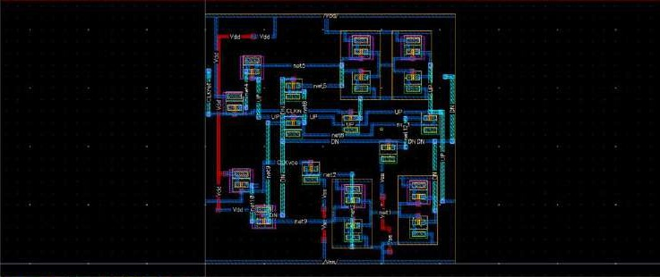
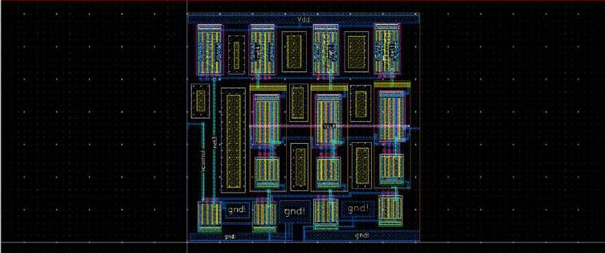
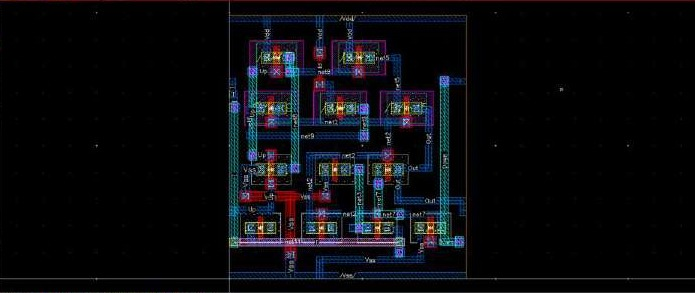
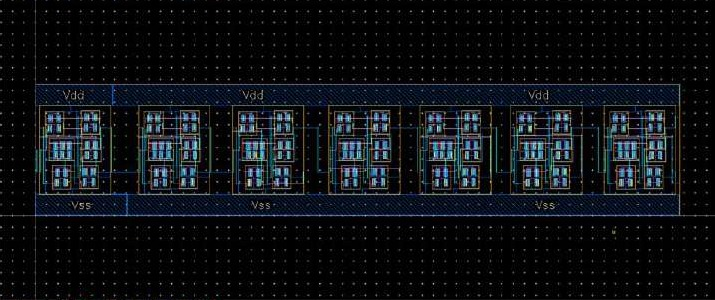
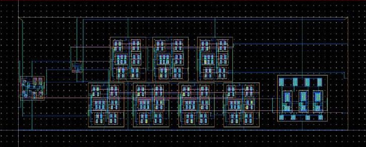

# Physical Layout and Parasitic Considerations

> Evidence: [R1] pp. 5–7, 13–15, 19–20, 26–28, 31 · [`layout/`](../layout) · [`reports/drc/`](../reports/drc)

## 1. What was laid out

All layouts were drawn in **Virtuoso Layout Suite XL** with the **SCL 180 nm** primitive library `ts018_scl_prim`, which is visible in the layout palette. The hierarchy was built bottom-up:

| Level | Cell | Screenshot | Calibre DRC |
|---|---|---|---|
| leaf | inverter (used in the PFD) | [pfd-inverter-layout](../layout/pfd/pfd-inverter-layout.jpg) | `GC.C.1` ×1 |
| leaf | `vco_inverter` | [vco-inverter-layout](../layout/vco/vco-inverter-layout.jpg) | `GC.C.1` ×1 |
| leaf | `nand_2` | [nand2-layout](../layout/divider/nand2-layout.jpg) | `GC.C.1` ×1 |
| leaf | `nand_3` | [nand3-layout](../layout/divider/nand3-layout.jpg) | `GC.C.1` ×1 |
| block | `pfd_implement` | [pfd-layout](../layout/pfd/pfd-layout.jpg) | `GC.C.1` ×1 |
| block | `vco_layout` | [vco-layout](../layout/vco/vco-layout.jpg) | `M2.C.1` ×1 |
| block | `charge_pump` | [charge-pump-layout](../layout/charge-pump/charge-pump-layout.jpg) | `GC.C.1` ×1 |
| block | `d_ff` | [dff-layout](../layout/divider/dff-layout.jpg) | `GC.C.1` ×1 |
| block | `divided_by_128counter` | [divide-by-128-layout](../layout/divider/divide-by-128-layout.jpg) | `GC.C.1` ×1 |
| top | `pll_arch` | [pll-top-layout](../layout/pll/pll-top-layout.jpg) | `GC.C.1` ×1 |

Details of the DRC results are in [physical-verification.md](physical-verification.md).

## 2. Block-by-block layout notes

### PFD

The layout is compact: inverter-based output stages, with the precharge and reset devices placed in between. The report's layout concern is **symmetry of the two clock paths** ([R1] p. 7): *"Symmetry should be maintained in routing and placing clock nets … An asymmetrical routing will cause an artificial phase delay and increase the 'dead zone' of the PFD."*

### VCO

The 100 µm PMOS and 50 µm NMOS inverter devices are **folded into multiple parallel fingers**, giving a compact rectangle with lower gate resistance and junction capacitance ([R1] p. 15). Limiter and bias devices line the VDD and gnd! rails. `Vcontrol` and `Vout` are labelled. The concern is **equal stage-to-stage routing**, so that every stage sees the same load and the ring's delays stay matched.

### Charge pump

PMOS devices sit in the upper rows and NMOS devices in the lower rows. The UP/DOWN branches need matched devices and matched routing, because any I_up/I_dn mismatch becomes a static phase offset ([charge-pump.md](charge-pump.md)). No common-centroid arrangement is documented, so none is claimed.

### Divider

Seven identical `d_ff` instances sit in one row on shared Vdd/Vss rails. The regular placement gives each stage identical internal parasitics and short, uniform ripple connections.

### Top level

The top level shows seven repeated cells in two rows (consistent with the divider flip-flops), a block on the right with large multi-finger devices, smaller blocks on the left, and long horizontal interconnect. Blocks are **not labelled** in the screenshot, so no annotated version is provided. No loop-filter R/C structure is identifiable.

## 3. Parasitic and layout considerations

These are the effects the report identifies. They are explained here as engineering principles; **none was quantified**, because no RC extraction was run.

| Effect | Where it matters | Consequence | Report reference |
|---|---|---|---|
| Wire **capacitance** on internal nodes | VCO ring nodes | increases C_load per stage, so t_d rises and f_max falls | [R1] p. 15, p. 31: post-layout frequency *"expected to be somewhat lesser"* |
| Wire and gate **resistance** | wide VCO devices, long top-level routes | RC delay and slower edges; mitigated by finger folding | [R1] p. 15 |
| **Clock-path mismatch** | PFD inputs, divider feedback | static phase offset and a wider dead zone | [R1] p. 7 |
| **Delay mismatch between ring stages** | VCO | asymmetric delays; with noise coupling, more jitter and phase noise | [R1] p. 15, p. 31 |
| **Charge sharing** at switch nodes | charge pump | glitches on V_CP during switching | [R1] p. 19 |
| **Density-rule shortfall** | every cell | the foundry requires minimum layer coverage; the fill needed to meet it adds its own capacitance | [R1] p. 7 |

**Frequency reduction after layout.** The report *expects* the post-layout maximum oscillation frequency to fall below the schematic-level 4.2067 GHz. This is the right expectation, because extraction adds capacitance to every ring node. It remains **unmeasured**.

## 4. Area

No area figure is reported. The top-level layout screenshot shows a cursor-ruler readout, but it is not an area measurement, so **no area is claimed**.
