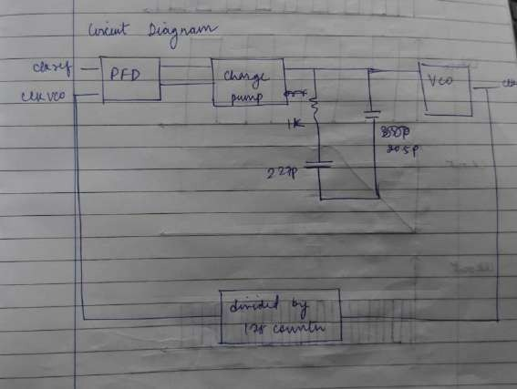

# Loop Filter

> Evidence: [R1] p. 29 (PLL aim, hand-drawn PLL circuit, Virtuoso schematic `pll_arch`) · [R1] p. 17 / [R2] p. 4 (single capacitor in the stand-alone charge-pump test)

## 1. What is actually implemented

Two different filters appear in the project, so they are kept apart here.

| Context | Filter | Evidence |
|---|---|---|
| Stand-alone charge-pump test | a **single capacitor** on each output (`Out1`, `Out2`) acting as the "loop filter" | [R1] p. 17: *"Connect a capacitor on the output node as a loop filter."* Test-setup drawing [R2] p. 3. The value is not legible. |
| Integrated PLL (`pll_arch`) | a **second-order passive filter**: R in series with C1 from the charge-pump output to ground, plus C2 directly from that node to ground | PLL aim [R1] p. 29: *"R = 1 kΩ, C = 227 pF … C2 = 35 pF"*. The hand-drawn PLL circuit shows "1k", "227p" and "35pF", and the Virtuoso schematic shows a resistor + capacitor branch and a separate capacitor on the charge-pump → VCO net. |

```
 charge pump Out ──●─────────────●──────► VCO Vcontrol   (node V_CP)
                   │             │
                   R = 1 kΩ      C2 = 35 pF
                   │             │
                   C1 = 227 pF  GND
                   │
                  GND
```

| Hand-drawn PLL circuit | Virtuoso top-level schematic |
|---|---|
|  |  |

Component values are from the design specification and the hand-drawn circuit. Labels in the Virtuoso screenshot are too small to read, so the screenshot confirms the **topology**, not the values.

**Initial condition.** The aim also lists *"i_c2 = 600 mV"*. This most plausibly means an initial-condition (`ic`) setting of 600 mV on the filter node, a common Spectre technique for starting the loop at a defined control voltage. It is consistent with the simulated `V_CP` trace, which starts at about 600 mV (see [pll-integration.md](pll-integration.md)). This reading is an interpretation and the report does not spell it out.

## 2. How it generates the control voltage

- **C1 (227 pF)** integrates the charge-pump current. This is the integrator that makes the loop type-II, so that at lock the static phase error is driven towards zero for an ideal pump.
- **R (1 kΩ)** in series with C1 adds a **zero**. Without it, a charge pump driving a pure capacitor gives two integrators (C1 and the VCO's phase integration) and the loop is unstable. The zero restores phase margin.
- **C2 (35 pF)** smooths the voltage step I_CP × R that appears across R on every pump pulse. It adds a higher-frequency **pole** and reduces ripple on V_CP, at some cost in phase margin.

## 3. Values derived from the design numbers (calculation, not measurement)

| Quantity | Formula | Value |
|---|---|---|
| Zero | f_z = 1 / (2π R C1) | 1 / (2π · 1 kΩ · 227 pF) ≈ **701 kHz** |
| Series capacitance | C1·C2 / (C1 + C2) | 227 · 35 / 262 ≈ **30.3 pF** |
| Pole | f_p = 1 / (2π R · C1C2/(C1+C2)) | ≈ **5.25 MHz** |
| Pole/zero ratio | f_p / f_z = 1 + C1/C2 | ≈ **7.5** |
| Ripple step on V_CP at the start of a pump pulse (upper bound) | I_CP · R | 0.1–0.15 V for I_CP = 100–150 µA |

These are properties of the filter alone. The **loop bandwidth, phase margin and damping factor** also depend on the small-signal K_VCO at the operating point, the actual I_CP and N = 128. Neither K_VCO nor I_CP was measured at the operating point, so **those loop parameters are not reported**.

The reference frequency (20 MHz) is about 4× above f_p, so C2 attenuates reference-rate ripple only modestly. Visible ripple on `V_CP` at the reference rate is therefore expected (see [pll-integration.md](pll-integration.md)).

## 4. Physical implementation

The top-level layout screenshot ([`layout/pll/pll-top-layout.jpg`](../layout/pll/pll-top-layout.jpg)) does not show an identifiable resistor or capacitor structure. 262 pF of on-chip capacitance would normally dominate the area of a block this size. The reports do not say whether R, C1 and C2 were laid out, so **the loop filter should be treated as schematic-level, possibly ideal, components**.

## 5. Not available

- Loop bandwidth, phase margin, damping factor.
- AC or stability analysis of the loop.
- Layout of the filter components.
