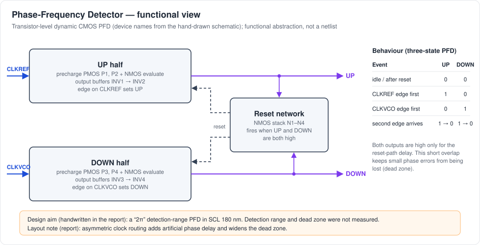
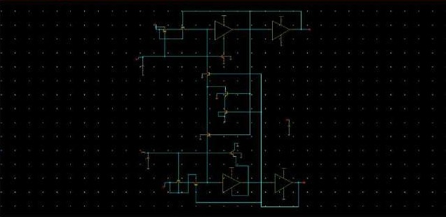
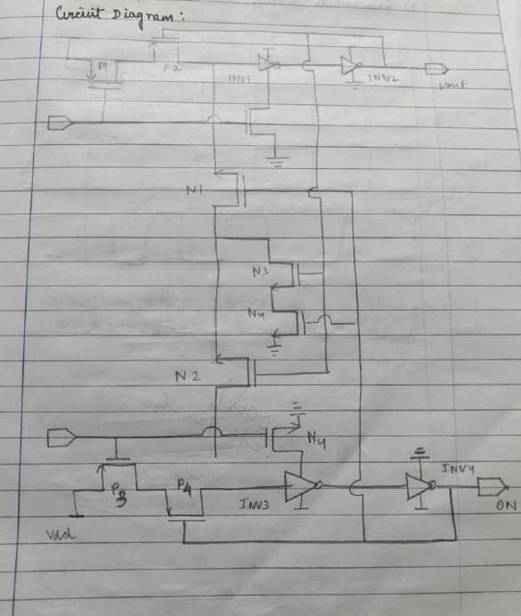
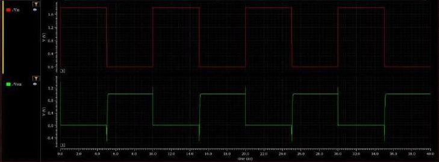
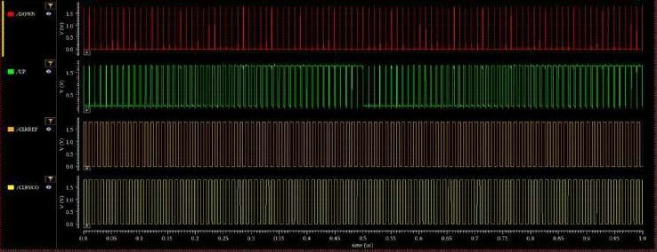
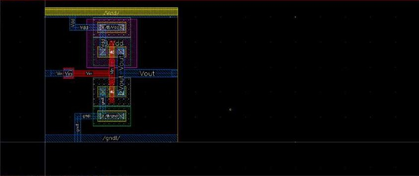

# Phase-Frequency Detector (PFD)

> Evidence: [R1] pp. 2–7 · schematics in [`schematics/pfd/`](../schematics/pfd) · waveforms in [`simulations/pfd/`](../simulations/pfd) · layout in [`layout/pfd/`](../layout/pfd) · DRC in [`reports/drc/`](../reports/drc)
> Source key: see [evidence-audit.md](evidence-audit.md).

## 1. Role in the PLL

The PFD compares the reference clock (`CLKREF`, design value 20 MHz) with the divided VCO clock that comes back from the ÷128 divider. In the stand-alone PFD testbench this input is labelled `CLKVCO`. The PFD produces two pulse-width-modulated outputs:

| Output | Asserted when | Effect downstream |
|---|---|---|
| `UP` | the `CLKREF` edge arrives before the feedback edge | charge pump sources current, so V_CP rises and the VCO speeds up |
| `DOWN` | the feedback edge arrives before the `CLKREF` edge | charge pump sinks current, so V_CP falls and the VCO slows down |

`UP` and `DOWN` are therefore pulses whose width equals the phase error. If the two inputs differ in **frequency**, the edge that keeps arriving first keeps winning, so the PFD also steers frequency, not just phase. That is the "frequency" in phase-frequency detector.

## 2. Implementation

The design aim, handwritten in [R1] p. 2, is: *"design and implement a 2π detection-range PFD architecture in SCL 180 nm technology."* The aim reads as "2π" or "2x" in the handwriting. The detection range itself was **not** characterised.

The circuit is a **transistor-level dynamic CMOS PFD**. It is drawn by hand in [R1] p. 2 and entered in Virtuoso Schematic Editor as cell `pfd_implement` with an `inverter` sub-cell ([R1] pp. 3–4).

| Group (hand-drawn names) | Function |
|---|---|
| P1, P2 + input NMOS, INV1 → INV2 | `UP` half: the reference edge sets the internal node; the two inverters buffer and restore it to full swing at `UP` |
| P3, P4 + input NMOS, INV3 → INV4 | `DOWN` half: same structure, driven by the feedback clock (output pin drawn as "ON"/DN) |
| N1–N4 NMOS stack | shared reset path: when both outputs are high, the internal nodes are pulled down, so both halves return to the idle state |

[R1] p. 7 summarises the structure as *"D-Flip Flops and resets"*. Functionally that is correct: the two half-circuits behave as two edge-triggered state elements with a common reset. The drawn circuit, however, uses no explicit DFF cells; it is realised directly in precharge/evaluate transistors.

| Schematic | Hand-drawn circuit |
|---|---|
|  |  |

Zoomed views: [UP half](../schematics/pfd/pfd-schematic-zoom-up-half.jpg) · [DOWN half](../schematics/pfd/pfd-schematic-zoom-down-half.jpg).

Transistor W/L values for the PFD are not documented in the reports.

## 3. State behaviour

| Event | UP | DOWN |
|---|:-:|:-:|
| idle / after reset | 0 | 0 |
| `CLKREF` edge arrives first | 1 | 0 |
| feedback edge arrives first | 0 | 1 |
| the other edge arrives | 1 → 0 | 1 → 0 (after the reset-path delay) |

The state `UP = DOWN = 1` exists only for the delay of the reset path. That short overlap is intentional in any reset-based PFD. Without it, very small phase errors would generate pulses too narrow to switch the charge pump, which is the **dead zone**.

## 4. Simulation evidence

**Inverter sub-cell (transient).** The output is the logic inverse of the input with full-swing levels ([R1] p. 3).

**PFD transient, 0–1 µs** ([R1] p. 4). The traces are `/DOWN`, `/UP`, `/CLKREF` and `/CLKVCO`.

Interpretation (visual reading of the screenshot):

- `UP` carries wide pulses, while `DOWN` shows only narrow spikes. The reference therefore leads the feedback clock throughout this window, and the narrow `DOWN` spikes are the reset-overlap pulses described above.
- The `UP` pulse pattern changes around 0.5 µs. This is consistent with the phase difference drifting and wrapping between two clocks of unequal frequency. The input frequencies used in this testbench are not stated in the report.
- The behaviour matches the hand-drawn expected waveform ([R1] p. 5): [expected timing](../simulations/pfd/pfd-expected-timing-hand-drawn.jpg).

There is no quantitative PFD measurement (no dead-zone width, reset-pulse width, maximum operating frequency or detection-range plot).

## 5. Layout and DRC

| Inverter layout | PFD layout (`pfd_implement`) |
|---|---|
|  |  |

The PFD was laid out in Virtuoso Layout Suite XL using the SCL 180 nm primitive library (`ts018_scl_prim`, visible in the layout palette).

**DRC (Calibre RVE).** Both the inverter and the PFD runs report **one** result, and it is the density/coverage rule `GC.C.1` ("GC coverage less than 0.1"). No other rule check is flagged ([R1] p. 6).
[PFD DRC](../reports/drc/pfd-calibre-drc.jpg) · [inverter DRC](../reports/drc/pfd-inverter-calibre-drc.jpg)

The report's own words ([R1] p. 7):

> *"There were no critical issues during the Design Rule Check (DRC)… A common foundry density rule violation (GC.C.1) was encountered due to the small footprint of the PFD block… This issue was deliberately left as is since it may create unknown parasitics, which may affect the speed of the circuit."*

**The PFD is therefore not "DRC-clean" in the strict sense.** It passes all geometric rules shown, with one intentionally unresolved density rule.

## 6. Layout considerations specific to the PFD

The key observation in [R1] p. 7 is that **routing symmetry between the `CLKREF` and feedback paths matters**. Any extra wire capacitance or resistance on one input or output branch delays that branch only, and shows up as a static phase offset. It also widens the effective dead zone, because one output must overcome extra delay before it can switch the charge pump. Mirror-symmetric placement of the two halves and matched clock-net routing are the mitigations named in the report. Their effect was not quantified, because no extraction was run.

## 7. Not available

- Dead-zone width, reset-pulse width and phase-detection range: not measured.
- Transistor sizes: not documented.
- Extracted (post-layout) PFD simulation: not performed.
