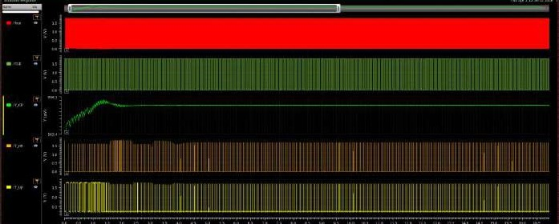
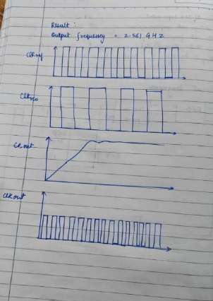

# Complete PLL Integration and Locking Behaviour

> Evidence: [R1] pp. 29–31 · [`schematics/pll/`](../schematics/pll) · [`simulations/pll/`](../simulations/pll) · [`layout/pll/`](../layout/pll)

## 1. Specification

Design aim, handwritten in [R1] p. 29 ([image](../schematics/pll/pll-design-targets-hand-written.jpg)):

> *"Design and implementation of a PLL architecture to produce an o/p frequency of 2.5 GHz, assume the values of R = 1 kΩ, C = 227 pF, value of I_c 100–150 µA, F_ref = 20 MHz, C₂ = 35 pF, i_c2 = 600 mV."*

| Parameter | Value | Status |
|---|---|---|
| Target output frequency | 2.5 GHz | design target |
| Reference frequency F_ref | 20 MHz | design value |
| Division ratio N | 128 | implemented (7-stage divider) |
| N × F_ref | 2.56 GHz | arithmetic; this is the frequency an exact ÷128 loop must settle to |
| Charge-pump current I_CP | 100–150 µA | design range |
| Loop filter | R = 1 kΩ, C1 = 227 pF, C2 = 35 pF | design values ([loop-filter.md](loop-filter.md)) |
| Initial condition on the filter node | 600 mV | design value (interpretation of "i_c2") |

The nominal 2.5 GHz target and the 2.56 GHz implied by N = 128 and F_ref = 20 MHz differ by 2.4 %. With an integer ÷128 divider and a 20 MHz reference, the loop can only lock at 2.56 GHz.

## 2. Top-level schematic (`pll_arch`)

The schematic contains **17 instances**: the `pfd` symbol, the `charge_pump` symbol, the loop-filter R, C1 and C2, the VCO symbol, the `divided_by_128counter` symbol, and the supply and stimulus sources. Signal flow:

1. The reference clock drives the PFD's first input.
2. The PFD `UP`/`DN` outputs drive the charge pump's `Up`/`Down` inputs.
3. The charge-pump `Out` drives the loop-filter node, which is wired to the VCO's control input (**V_CP**).
4. The VCO output (**Vout**) is the PLL output. It is also wired down to the divider's clock input.
5. The divider output is wired back to the PFD's second input (feedback).

## 3. Signal flow and control behaviour

| Step | Signal | What happens |
|---|---|---|
| Phase/frequency comparison | `CLKREF` vs `FB` | The PFD emits `UP` when the reference edge is first and `DOWN` when the feedback edge is first. The pulse width equals the time difference. |
| Charge conversion | I_CP | The charge pump converts each pulse into a charge packet ±I_CP·t_pulse. |
| Integration + filtering | V_CP | C1 integrates the packets, R provides the stabilising zero and C2 smooths the per-pulse step. |
| Frequency control | V_CP → f_Vout | A higher V_CP gives more starving current, a shorter stage delay and a higher VCO frequency. |
| Division + feedback | f_FB = f_Vout/128 | The divided clock returns to the PFD and closes the negative-feedback loop. |

**Expected lock mechanism (general):**

- If f_Vout < 2.56 GHz, then f_FB < 20 MHz. The reference edges arrive first, `UP` dominates and V_CP climbs.
- As V_CP climbs, f_Vout rises until f_FB = f_REF.
- The PFD then works on the residual phase error until the `UP`/`DOWN` pulses shrink to the reset-overlap width.
- The type-II loop (integrating C1) drives the static phase error towards zero for a matched charge pump.

## 4. Locking behaviour — what the simulation actually shows

### 4.1 Control-voltage evolution

The `/V_CP` trace ([R1] p. 30), read visually from a low-resolution screenshot (approximate):

| Phase | Approximate observation |
|---|---|
| Initial state | V_CP starts at about **600 mV**, consistent with the 600 mV initial condition |
| Acquisition | V_CP climbs in a **sawtooth staircase**. Each tooth is a charge-pump packet followed by partial relaxation through R–C2, at the reference rate. |
| Overshoot | V_CP peaks at about **0.96 V** a little after 1 µs |
| Settling | damped ringing, then a nearly flat level of about **0.9 V**, reached within the first few microseconds and held for the rest of the window |

The shape of an under-damped second-order step response is what a type-II charge-pump PLL with this filter should produce during acquisition. Two horizontal markers in the screenshot bracket the settled level. Their numeric values are not legible.

### 4.2 Full transient

The overview window (0 to about 16.5 µs) shows five traces:

- `/Vout`: the VCO output, too dense to resolve at this zoom.
- A second clock trace (green).
- `/V_CP`, the same acquisition-and-settle shape as above.
- Two PFD-output traces (DN/UP).

After V_CP settles, the PFD-output activity becomes regular, which is consistent with steady-state operation.

### 4.3 Recorded result

The handwritten result in [R1] p. 30 records **"Output frequency = 2.56 GHz"**, which equals N × F_ref. The notebook sketch beneath it shows `CLKREF`, the feedback clock, the control voltage rising then flattening, and the output clock. It is a **sketch**, not simulation data.

**Visual cross-check (approximate).** On the stand-alone VCO's f–V curve ([vco.md](vco.md)), a control voltage of about 0.9 V corresponds to roughly 2.5–2.6 GHz. That agrees with the settled V_CP and the recorded 2.56 GHz output. Both readings are visual, from different testbenches, and the VCO inside the loop carries a different load.

### 4.4 Honest summary

> The transient simulation demonstrates **acquisition and settling of the control voltage** in the closed loop, and the report records a 2.56 GHz output (= 128 × 20 MHz). A **formal lock characterisation is not available**:
>
> - there is no measured lock or settling time (no `cross`/settling measurement, only visual reading);
> - there is no measured output frequency in the screenshots (the 2.56 GHz value is handwritten);
> - there is no residual phase-error or static-offset measurement between `CLKREF` and `FB`;
> - there is no jitter, phase-noise or reference-spur measurement;
> - there is no loop-bandwidth, phase-margin or damping extraction.

## 5. Top-level layout

The `pll_arch` layout ([R1] p. 31) shows:

- **Seven repeated identical cells** arranged in two rows (3 + 4). This is consistent with the seven divider flip-flops.
- One block on the right containing large multi-finger devices.
- Smaller blocks on the left.

Blocks are not labelled in the screenshot, so this repository **does not annotate** which block is the PFD, charge pump or VCO. No loop-filter R/C structure is identifiable (see [loop-filter.md](loop-filter.md)).

DRC: Calibre reports **one** result for `pll_arch`, the density rule `GC.C.1` ([DRC](../reports/drc/pll-top-calibre-drc.jpg)).

The report's conclusions ([R1] p. 31):

> *"The overall physical implementation of the PLL circuit design has been done using the 180 nm technology node. Symmetrical routing in the delay chain is very important for the stability of the system and minimizing the jitter. The post layout maximum oscillation frequency performance is expected to be somewhat lesser than simulation performance due to parasitics effect."*

The post-layout statement is an **expectation**. No extracted simulation exists.

## 6. Next characterisation steps

1. Measure the settling time with an ADE calculator expression, for example the time after which |V_CP − V_final| stays below a small tolerance.
2. Measure `frequency(Vout)` and `frequency(FB)` over the last few microseconds and confirm f_FB = f_REF.
3. Measure the static phase offset between `CLKREF` and `FB` edges at lock.
4. Run a periodic-steady-state plus `pnoise` (or a transient-noise) analysis for jitter and phase noise.
5. Extract the small-signal K_VCO around 0.9 V and compute the loop bandwidth and phase margin with I_CP, R, C1, C2 and N = 128.
6. Repeat after RC extraction of the layout.
