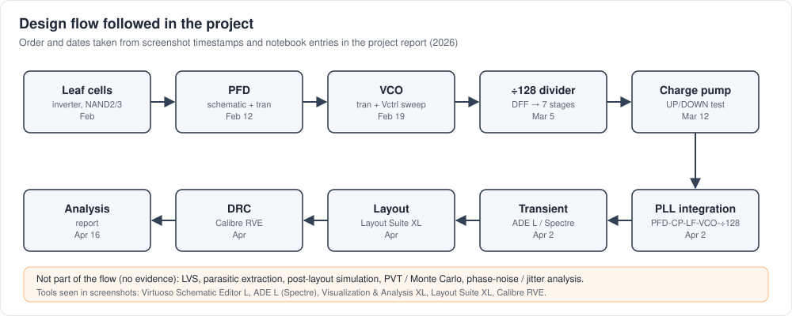

# PLL Overview


## What a PLL does

A phase-locked loop is a negative-feedback system that makes an oscillator's output track a reference clock in **phase**, and therefore in **frequency**. With a ÷N divider in the feedback path, the loop forces

```
f_out / N = f_ref      →      f_out = N · f_ref
```

so a clean, low-frequency reference (here a 20 MHz design value) can be multiplied up to a high-frequency clock (here N = 128, giving 2.56 GHz).

## The loop in this project

| # | Block | Implementation in this project | Doc |
|---|---|---|---|
| 1 | Phase-frequency detector | transistor-level dynamic CMOS PFD with shared NMOS reset network | [pfd.md](pfd.md) |
| 2 | Charge pump | current-mirror charge pump: PMOS source / NMOS sink switched by UP / DOWN | [charge-pump.md](charge-pump.md) |
| 3 | Loop filter | 2nd-order passive: R = 1 kΩ + C1 = 227 pF in series, ‖ C2 = 35 pF | [loop-filter.md](loop-filter.md) |
| 4 | VCO | 3-stage current-starved ring, 107 MHz – 4.21 GHz over 0.514 – 1.8 V | [vco.md](vco.md) |
| 5 | Divider | 7-stage ripple counter of toggle DFFs (NAND-based), ÷128 | [divider.md](divider.md) |
| — | Integration | top-level schematic `pll_arch` and closed-loop transient | [pll-integration.md](pll-integration.md) |
| — | Layout | full custom layout of every block and of the top level | [layout.md](layout.md) |
| — | Verification | Calibre DRC on all cells; no LVS or extraction | [physical-verification.md](physical-verification.md) |

## Signal chain

```
CLKREF ─► PFD ─UP/DN─► Charge pump ─I_CP─► Loop filter ─V_CP─► VCO ─► Vout (PLL output)
           ▲                                                            │
           └──────────────── FB = Vout / 128 ◄──── ÷128 divider ◄───────┘
```

1. **PFD** detects which edge, reference or feedback, arrives first, and by how much.
2. **Charge pump** turns that time difference into a packet of charge (±I_CP × t).
3. **Loop filter** integrates the charge into the control voltage V_CP and shapes the loop dynamics.
4. **VCO** converts V_CP into frequency.
5. **Divider** scales the VCO output by 1/128 and feeds it back to the PFD.

The loop settles when the divided VCO edges line up with the reference edges. In the closed-loop transient, V_CP is seen to acquire and settle ([pll-integration.md](pll-integration.md)). Lock time, jitter and phase error were not measured.

## Design flow


