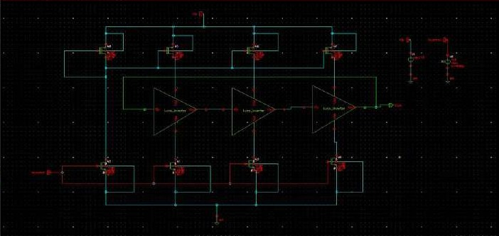
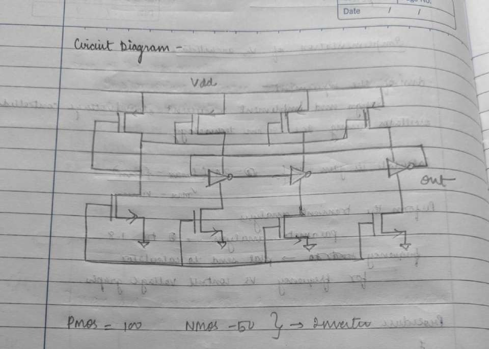
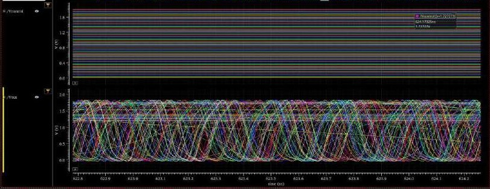
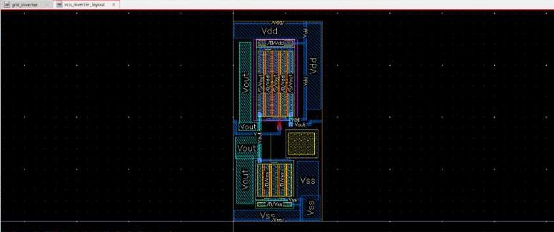

# Voltage-Controlled Oscillator (VCO)

> Evidence: [R1] pp. 8–15 · [`schematics/vco/`](../schematics/vco) · [`simulations/vco/`](../simulations/vco) · [`layout/vco/`](../layout/vco) · [`reports/drc/`](../reports/drc)


## 1. Architecture

The design aim ([R1] p. 8) is to *"design and implement a current-starved voltage-controlled oscillator using SCL 180 nm technology"*, calculate its gain K_VCO and plot frequency against control voltage.

The schematic `kvco_implement` ([R1] p. 9) is a **three-stage current-starved ring oscillator**:

| Element | Count | Role |
|---|---:|---|
| inverter cell `vco_inverter` | 3 | the delay stages, connected in a ring (output of stage 3 → input of stage 1) |
| NMOS limiter devices | 4 | one is the input device whose gate is `Vcontrol`; three starve the inverters' pull-down current |
| PMOS limiter devices | 4 | one is diode-connected (the mirror reference); three mirror the bias into the inverters' pull-up path |
| schematic instances in total | 16 | including testbench sources |

`Vcontrol` sets the current in the input NMOS. That current is mirrored to every stage's PMOS and NMOS limiters, so `Vcontrol` sets the current available to charge and discharge each stage's load capacitance.

| Virtuoso schematic | Hand-drawn circuit |
|---|---|
|  |  |

### Device sizing (documented)

| Device | Value | Source |
|---|---|---|
| inverter PMOS width | 100 µm | [R1] p. 8 note "PMOS – 100, NMOS – 50 → inverter"; [R1] p. 15 |
| inverter NMOS width | 50 µm | same |
| channel lengths, finger count, limiter-device sizes | **not documented** | — |

The 2:1 PMOS:NMOS width ratio roughly compensates for lower hole mobility, so that the rise and fall delays of each stage are closer. Balanced rise/fall delays give a more symmetric output; this is a general principle, and output duty cycle was not measured.

## 2. Operating principle (general)

The delay of each stage is approximately

```
t_d ≈ C_load · (VDD/2) / I_starve(Vcontrol)
```

For a ring of N inverting stages,

```
f_osc ≈ 1 / (2 · N · t_d),   N = 3 here
```

so f_osc rises roughly in proportion to the starving current. Above threshold, that current rises with `Vcontrol` until the limiter devices are no longer the bottleneck. At that point the inverters' own drive strength sets the delay and the curve flattens. Both regions are visible in the measured sweep below.

## 3. Simulation methodology (from [R1] p. 10)

| Item | Setting recorded in the report |
|---|---|
| Transient source for `Vcontrol` | `vpulse`: V1 = 0, V2 = 1.8 V, period = 10 ns, width = 10 ns, rise/fall = 10 ps, delay = 0 |
| Transient stop time | 1 µs |
| Parametric analysis | V2 replaced by a design variable `V`, swept 0 → 1.8 V, "auto, steps 10" |
| Frequency extraction | ADE calculator expression `frequency(getData("/Vout" ?result "tran"))` plotted against `V` (visible in the screenshot) |
| Simulator | Spectre via ADE L (status bar "Simulator: spectre") |

Procedure page: [vco-procedure-hand-written.jpg](../simulations/vco/vco-procedure-hand-written.jpg)

## 4. Results

### 4.1 Oscillation (transient)


`Vcontrol` is held high, with one brief dip at the pulse edge, and `Vout` oscillates continuously. The waveform is rounded and, on visual inspection, does not reach the full supply rails. That is typical of a lightly-buffered ring running near its maximum speed. Over a longer window (`Vcontrol` pulsed), the output shows sustained oscillation: [vco-transient-vcontrol-pulse.jpg](../simulations/vco/vco-transient-vcontrol-pulse.jpg).

The `vco_inverter` cell was verified on its own first: [vco-inverter-transient.jpg](../simulations/vco/vco-inverter-transient.jpg).

### 4.2 Parametric sweep



Overlaid `Vout` traces for the swept control voltages show the oscillation period shortening as `Vcontrol` increases. Zoom: [vco-parametric-sweep-zoom.jpg](../simulations/vco/vco-parametric-sweep-zoom.jpg).

### 4.3 Frequency vs. control voltage


| Quantity | Value | How obtained |
|---|---|---|
| f_min | **107.12 MHz** at **V_min = 0.514 V** | marker on the f–V plot ([R1] p. 10) and the hand calculation ([R1] p. 12) |
| f_max | **4.2067 GHz** at **V_max = 1.8 V** | hand calculation ([R1] p. 12) |
| K_VCO (average) | **20.03 × 10⁹ rad/s/V** | [R1] p. 12: 2π (f_max − f_min) / (V_max − V_min) = 2π × 4099.58 MHz / 1.286 V |
| K_VCO in Hz/V | ≈ 3.19 GHz/V | 4099.58 MHz / 1.286 V (derived here from the same numbers) |
| f_c (centre) | **2.15691 GHz** | (f_max + f_min)/2 ([R1] p. 13) |
| Tuning range | **190.067 %** | (f_max − f_min)/f_c × 100 ([R1] p. 13) |

Hand calculations: [page 1](../simulations/vco/vco-kvco-calculation-1.jpg) · [page 2](../simulations/vco/vco-kvco-calculation-2.jpg).
I re-checked the arithmetic: 2π × 4099.58 × 10⁶ / 1.286 = 2.003 × 10¹⁰ rad/s/V, and 4.09958 / 2.15691 = 1.9007 (190.07 %).

**How to read K_VCO.** The reported K_VCO is an **average, end-point slope** over a strongly non-linear curve:

- Below about 0.5 V the starving NMOS is near or below threshold. The trace is flat around 0.1 GHz, and the `frequency()` output there should not be treated as a valid oscillation frequency, which is why V_min is taken at the 0.514 V marker.
- Between about 0.6 V and 1.1 V the curve is steepest, so the local small-signal gain is well above the average.
- Above about 1.3 V the curve saturates towards 4.2 GHz and the local gain is much smaller.

The small-signal K_VCO that matters for loop dynamics, measured at the PLL's operating point, was **not** extracted. The PLL settles with V_CP close to 0.9 V (see [pll-integration.md](pll-integration.md)), which sits in the steep part of this curve.

## 5. Layout

| `vco_inverter` layout | Full VCO layout (`vco_layout`) |
|---|---|
|  |  |

Documented in [R1] p. 15:

> *"Bigger sized transistors (100 µm PMOS and 50 µm NMOS) have been folded to multiple parallel fingers to make a compact rectangle with minimum wastage of space. This configuration also lowers down the resistance of the gates and parasitic junction capacitance, making it easier for high-frequency switching."*

Why folding helps (general principle): a 100 µm-wide single-finger device has a long, resistive poly gate and large source/drain diffusions. Splitting it into n fingers reduces gate resistance by roughly n² for a gate contacted at one end. Sharing diffusions between adjacent fingers also reduces junction area, and with it the drain capacitance that each stage must charge.

In the `vco_layout` screenshot the bias/limiter devices sit along the top (VDD) and bottom (gnd!) rails, the inverter devices sit in the middle row, and `Vcontrol` and `Vout` are labelled. The report stresses **matched routing between the stages**: *"Matching routing of delays is important to avoid discrepancies in delay, which can lead to jitter and phase noise."* ([R1] p. 15).

## 6. DRC

| Cell | Calibre result | Evidence |
|---|---|---|
| `vco_inverter_layout` | 1 result: `GC.C.1` (GC coverage < 0.1), a density rule | [DRC](../reports/drc/vco-inverter-calibre-drc.jpg) |
| `vco_layout` | 1 result: `M2.C.1` (M2 coverage < 0.20), a density rule | [DRC](../reports/drc/vco-calibre-drc.jpg) |

## 7. Parasitics and post-layout expectation

[R1] p. 15: *"As there would be parasitic capacitances and resistances while routing, simulation after layout may give lower values than the simulated circuit initially."*

This is an **expectation**, not a measurement. No RC extraction or post-layout simulation of the VCO was performed, so the post-layout f_max is unknown.

## 8. Not available

- Small-signal K_VCO at the PLL operating point.
- Phase noise or jitter of the VCO (no `pnoise` or noise analysis).
- Power consumption.
- Post-layout frequency range.
- Supply or temperature sensitivity.
